# All design mockups

Every design round for the De Quizfabriek ticket site, in order, from the first event-page redesign to the direction that was built. Each round links to its full write-up.

1. [First redesign of the event page](#1-first-redesign-of-the-event-page) (rejected: "looks very AI-built")
2. [Round 1: four themed directions](#round-1-four-themed-directions) (rejected: "too themed")
3. [Round 2: three abstract, clean directions](#round-2-three-abstract-clean-directions) (Kleurveld picked)
4. [Built: Kleurveld in the logo colours](#built-kleurveld-in-the-logo-colours)

Mockups use demo posters and copy. The HTML files open directly in a browser.

## 1. First redesign of the event page

A dark gradient hero holding the poster, fact pills, a white price and order card, and rounded ticket cards with a pink accent. This round fixed posters of any ratio and moved the order button up. The look was turned down as "very Claude-AI-built".

| Before, desktop | After, desktop | After, phone |
|---|---|---|
| 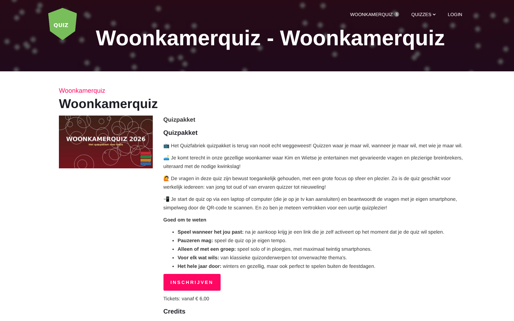 | 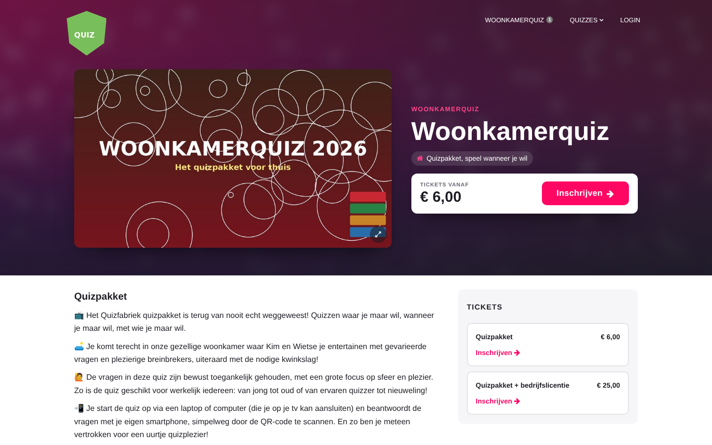 | 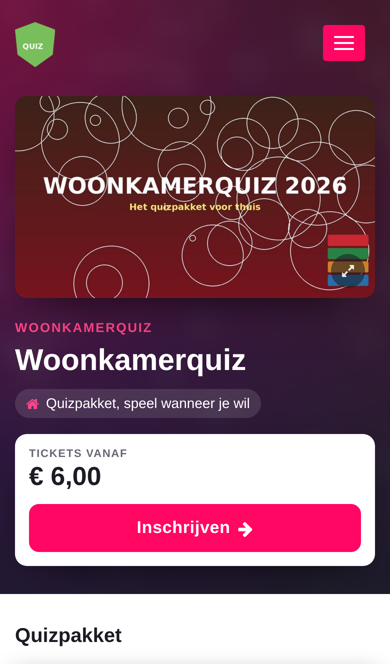 |

All screenshots, side by side: [screenshots/event-page](../screenshots/event-page/README.md)

## Round 1: four themed directions

Based on the tone of voice on quizfabriek.be. All four were turned down as "definitely too themed". Full write-up, with the tone-of-voice analysis: [2026-11-17/README.md](2026-11-17/README.md)

### A. Productielijn

Every quiz is a product coming off the factory line: kraft cardboard crates, a taped-on poster, a shipping label with the price, and a rubber stamp.

**Outcome:** Not chosen.

| Event page, desktop | Event page, phone | Rest of the site, desktop |
|---|---|---|
| 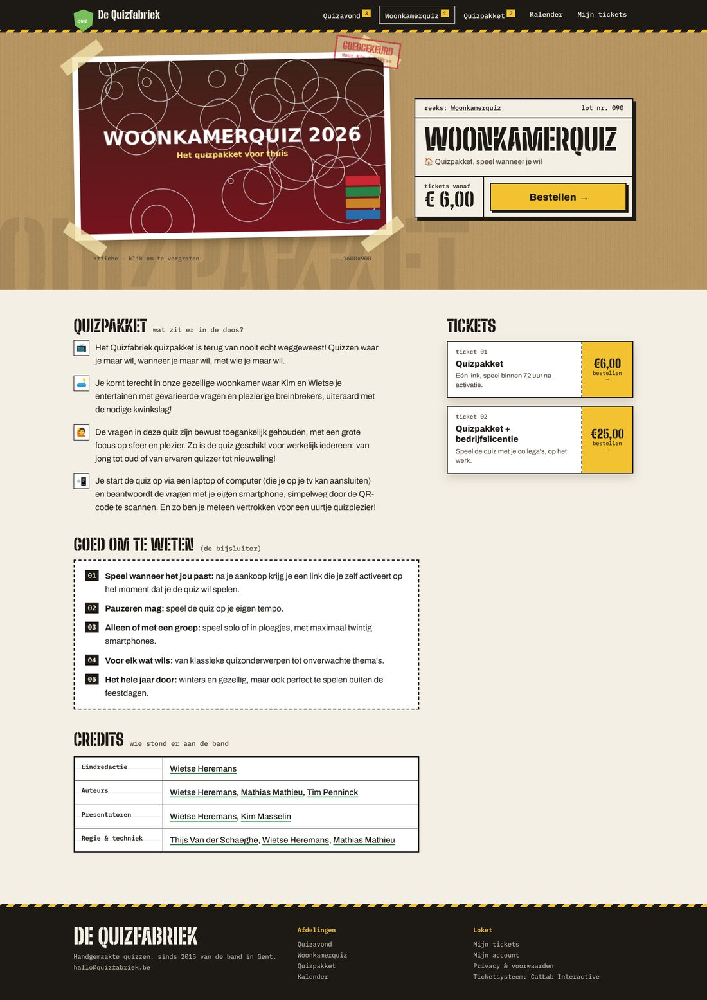 | 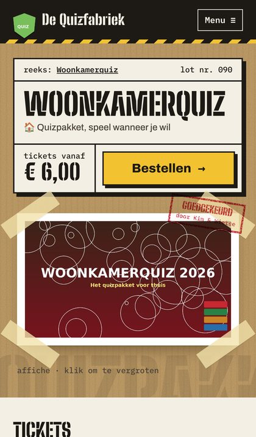 | 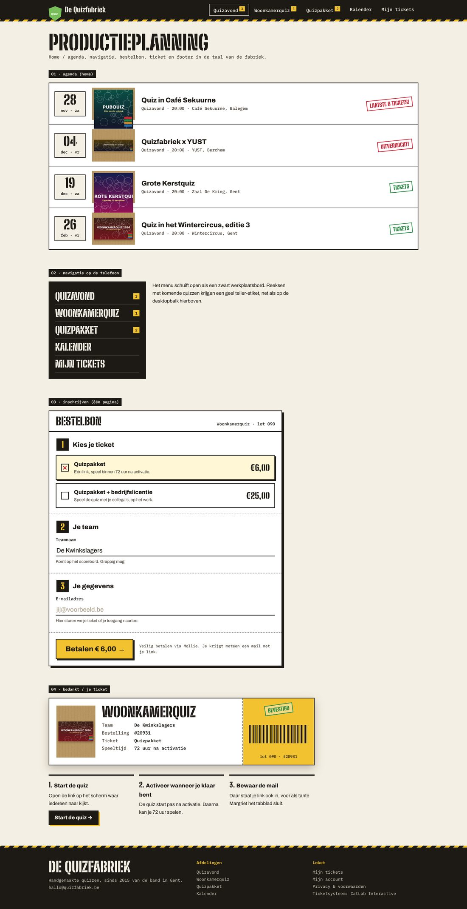 |

More: [portrait poster, desktop](2026-11-17/productielijn/event-portrait-desktop.jpg) · [portrait poster, phone](2026-11-17/productielijn/event-portrait-phone-fold.jpg) · [rest of the site, phone](2026-11-17/productielijn/rest-of-site-phone-full.jpg) · HTML mockups: [wide](2026-11-17/productielijn/event-wide.html), [portrait](2026-11-17/productielijn/event-portrait.html), [rest of site](2026-11-17/productielijn/rest-of-site.html)

### B. Antwoordknoppen

Everything is an answer button. The four colours of the Woonkamerquiz app (red, green, orange, blue) become the whole system, and each series owns one colour.

**Outcome:** Not chosen. It was recommended in this round, and its idea of one colour per series lives on in Kleurveld.

| Event page, desktop | Event page, phone | Rest of the site, desktop |
|---|---|---|
| 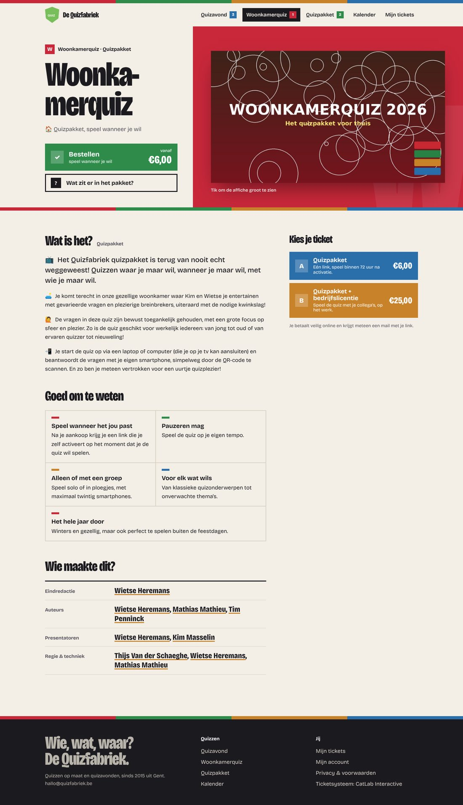 | 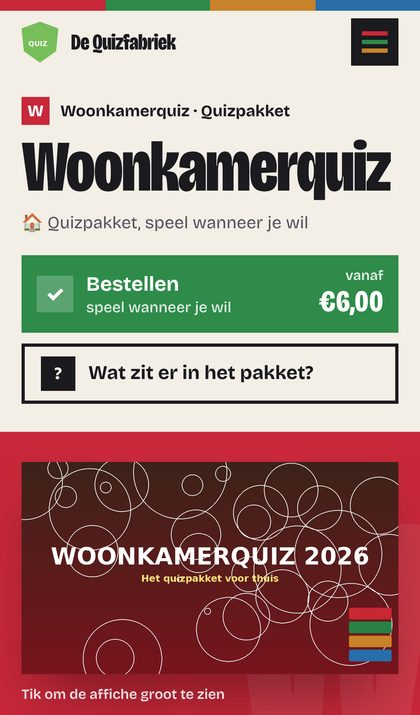 | 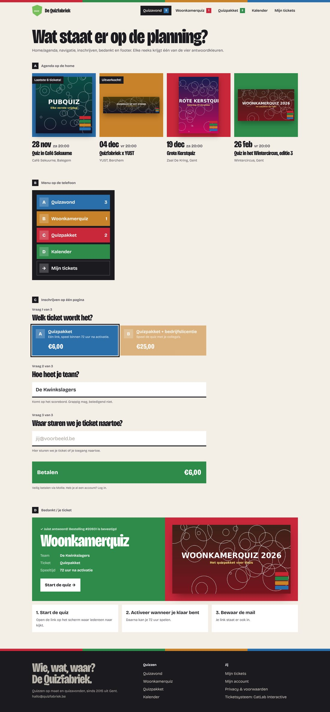 |

More: [portrait poster, desktop](2026-11-17/antwoordknoppen/event-portrait-desktop.jpg) · [portrait poster, phone](2026-11-17/antwoordknoppen/event-portrait-phone-fold.jpg) · [rest of the site, phone](2026-11-17/antwoordknoppen/rest-of-site-phone-full.jpg) · HTML mockups: [wide](2026-11-17/antwoordknoppen/event-wide.html), [portrait](2026-11-17/antwoordknoppen/event-portrait.html), [rest of site](2026-11-17/antwoordknoppen/rest-of-site.html)

### C. Huiskamer

Welcome to the living room: a 70s wallpaper hero, the poster framed on a nail, a two-colour risograph print, and an agenda that reads like a TV guide.

**Outcome:** Not chosen.

| Event page, desktop | Event page, phone | Rest of the site, desktop |
|---|---|---|
| 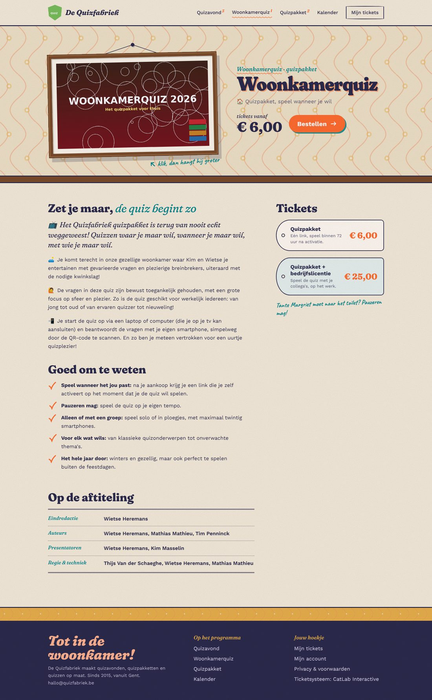 | 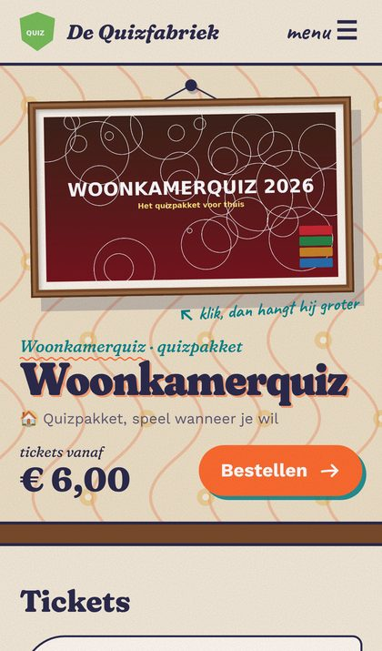 | 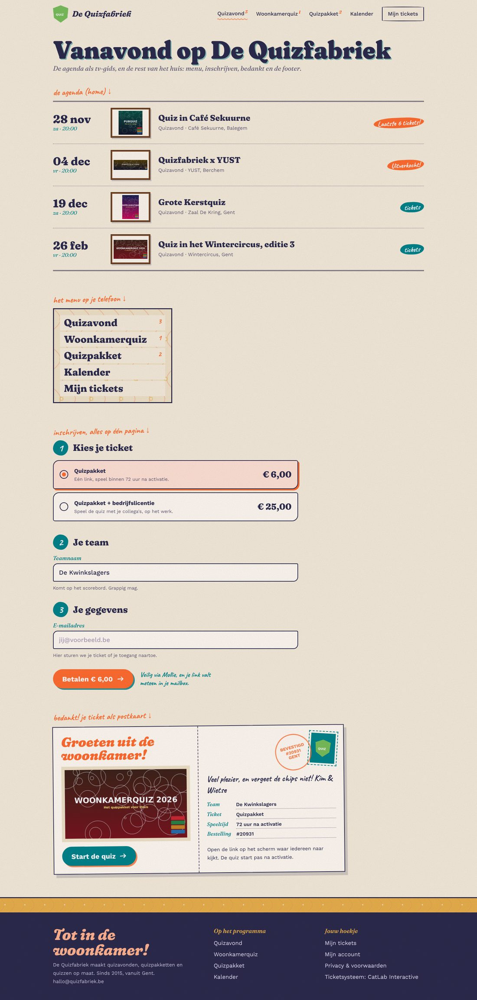 |

More: [portrait poster, desktop](2026-11-17/huiskamer-riso/event-portrait-desktop.jpg) · [portrait poster, phone](2026-11-17/huiskamer-riso/event-portrait-phone-fold.jpg) · [rest of the site, phone](2026-11-17/huiskamer-riso/rest-of-site-phone-full.jpg) · HTML mockups: [wide](2026-11-17/huiskamer-riso/event-wide.html), [portrait](2026-11-17/huiskamer-riso/event-portrait.html), [rest of site](2026-11-17/huiskamer-riso/rest-of-site.html)

### D. Affiche

A Flemish café or kermis poster meets the local newspaper: wood-type headlines, hairline rules and newspaper columns, in black plus vermilion.

**Outcome:** Not chosen.

| Event page, desktop | Event page, phone | Rest of the site, desktop |
|---|---|---|
| 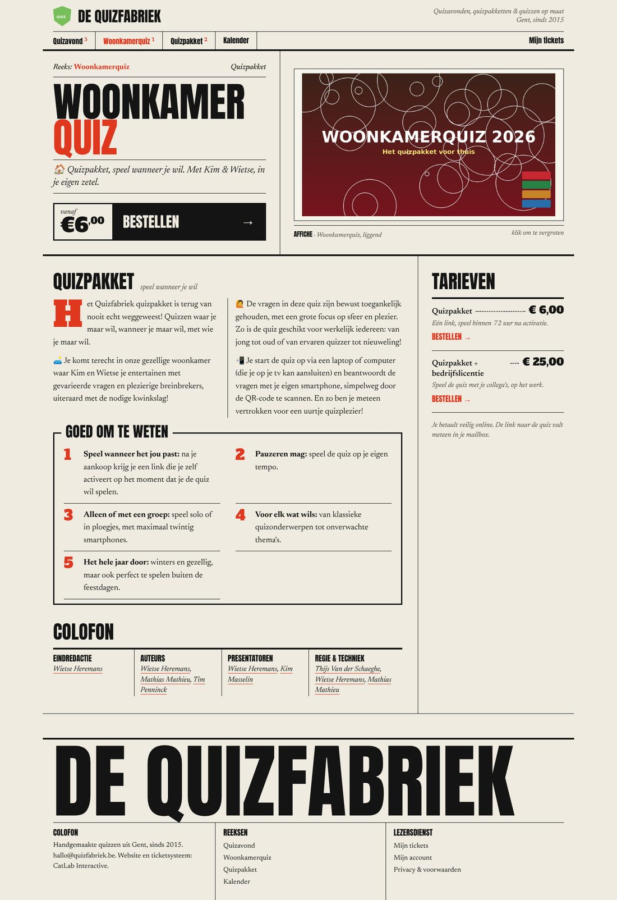 | 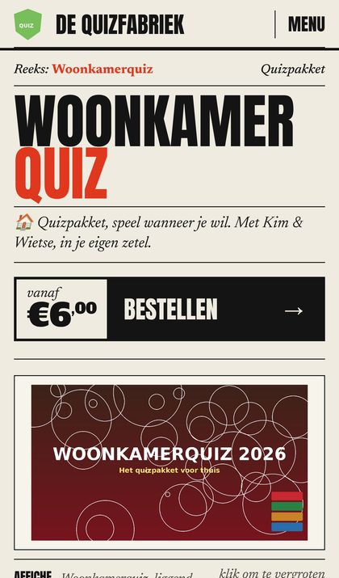 | 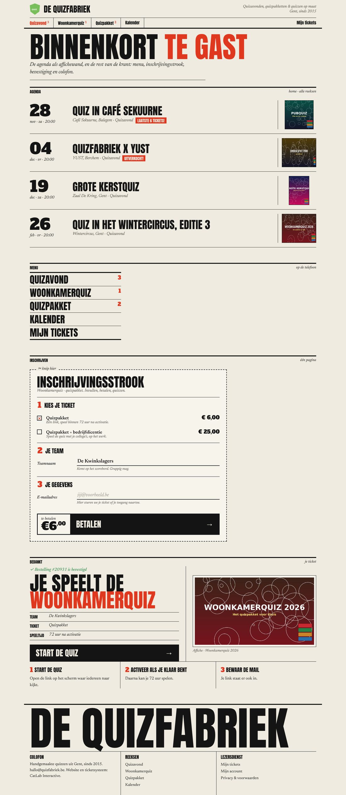 |

More: [portrait poster, desktop](2026-11-17/affiche/event-portrait-desktop.jpg) · [portrait poster, phone](2026-11-17/affiche/event-portrait-phone-fold.jpg) · [rest of the site, phone](2026-11-17/affiche/rest-of-site-phone-full.jpg) · HTML mockups: [wide](2026-11-17/affiche/event-wide.html), [portrait](2026-11-17/affiche/event-portrait.html), [rest of site](2026-11-17/affiche/rest-of-site.html)

## Round 2: three abstract, clean directions

No metaphors, props or textures. Each direction has a strict grid, one type choice and one abstract motif. Full write-up and comparison: [2026-11-18-clean/README.md](2026-11-18-clean/README.md)

### 1. Raster

The Swiss International Typographic Style: a visible 12-column grid with hairline rules, a title as large as the grid allows, blue for actions and red only for scarcity.

**Outcome:** Not chosen.

| Event page, desktop | Event page, phone | Rest of the site, desktop |
|---|---|---|
| 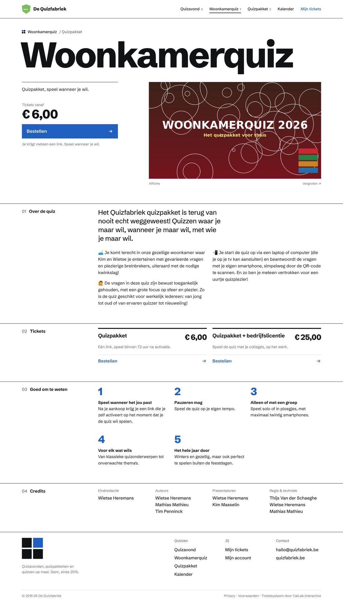 | 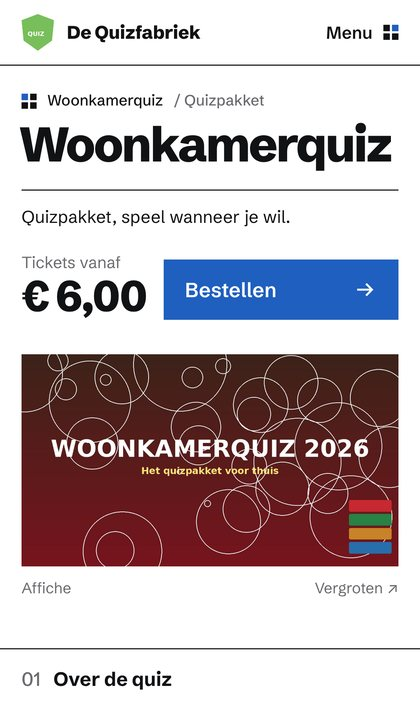 | 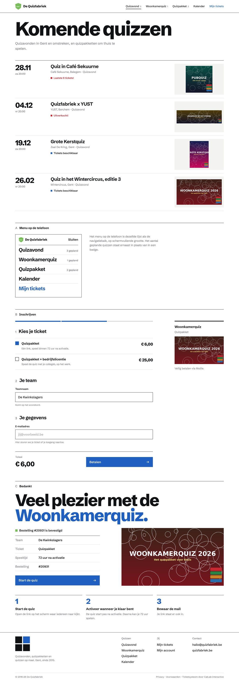 |

More: [portrait poster, desktop](2026-11-18-clean/raster/event-portrait-desktop.jpg) · [portrait poster, phone](2026-11-18-clean/raster/event-portrait-phone-fold.jpg) · [rest of the site, phone](2026-11-18-clean/raster/rest-of-site-phone-full.jpg) · HTML mockups: [wide](2026-11-18-clean/raster/event-wide.html), [portrait](2026-11-18-clean/raster/event-portrait.html), [rest of site](2026-11-18-clean/raster/rest-of-site.html)

### 2. Kleurveld

The poster sits on a flat field of soft colour with one or two large circles. Each series owns one colour, which colours its hero field, its navigation dot and its agenda tiles.

**Outcome:** Picked, with one change: use the logo colours and related tones instead of the softened answer colours.

| Event page, desktop | Event page, phone | Rest of the site, desktop |
|---|---|---|
| 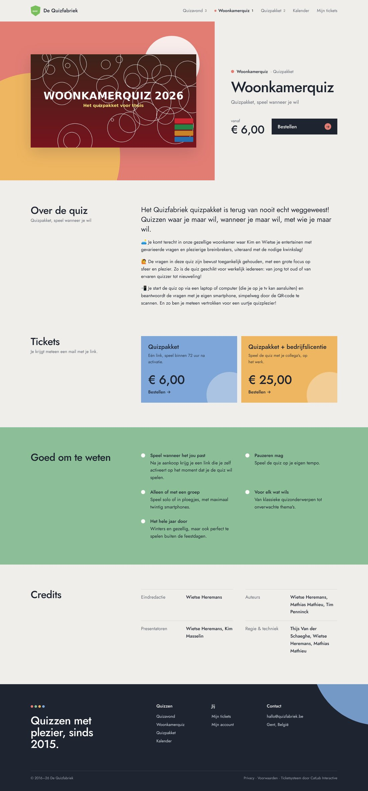 | 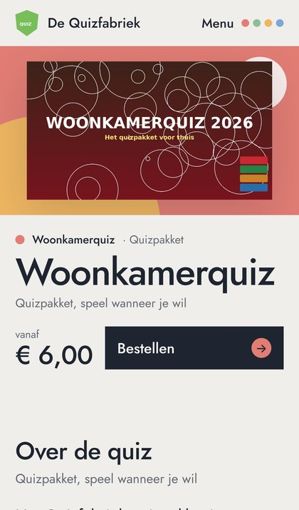 | 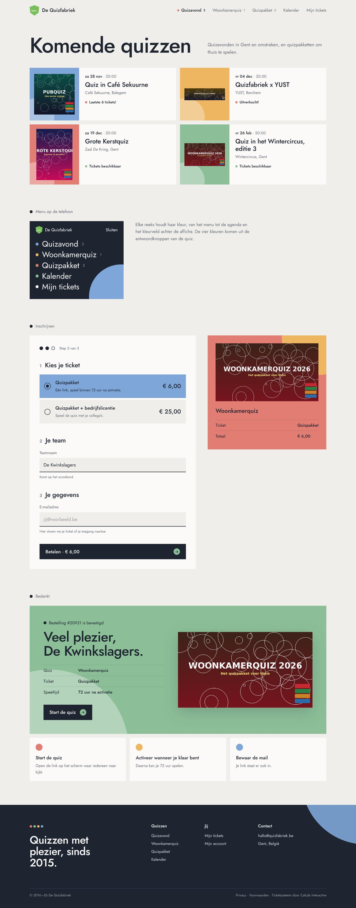 |

More: [portrait poster, desktop](2026-11-18-clean/kleurveld/event-portrait-desktop.jpg) · [portrait poster, phone](2026-11-18-clean/kleurveld/event-portrait-phone-fold.jpg) · [rest of the site, phone](2026-11-18-clean/kleurveld/rest-of-site-phone-full.jpg) · HTML mockups: [wide](2026-11-18-clean/kleurveld/event-wide.html), [portrait](2026-11-18-clean/kleurveld/event-portrait.html), [rest of site](2026-11-18-clean/kleurveld/rest-of-site.html)

### 3. Punt

Almost only type and white space, with one colour: the green from the logo in a deeper tone.

**Outcome:** Not chosen. It was the recommendation for this round.

| Event page, desktop | Event page, phone | Rest of the site, desktop |
|---|---|---|
| 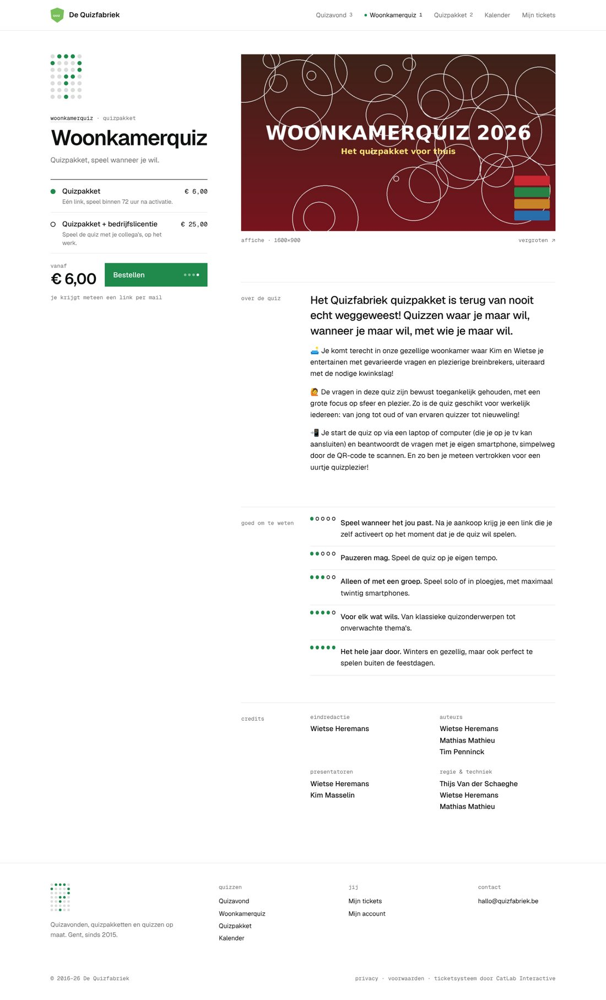 | 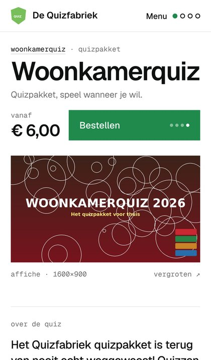 | 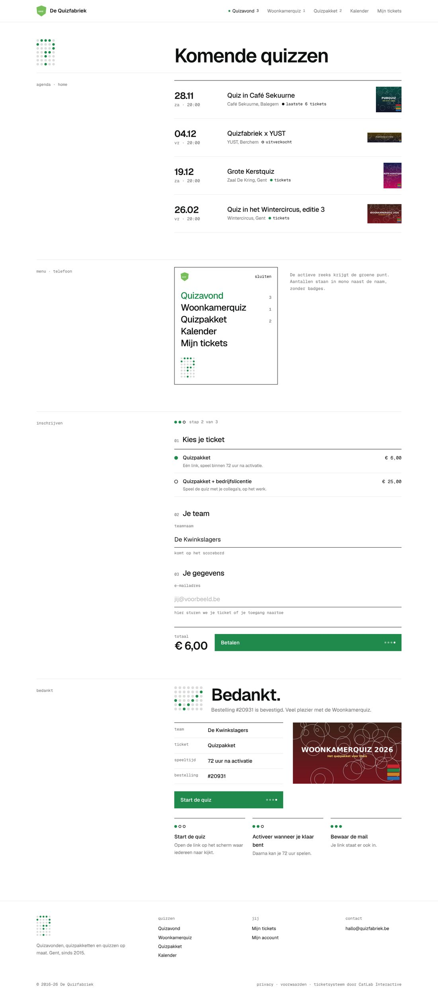 |

More: [portrait poster, desktop](2026-11-18-clean/punt/event-portrait-desktop.jpg) · [portrait poster, phone](2026-11-18-clean/punt/event-portrait-phone-fold.jpg) · [rest of the site, phone](2026-11-18-clean/punt/rest-of-site-phone-full.jpg) · HTML mockups: [wide](2026-11-18-clean/punt/event-wide.html), [portrait](2026-11-18-clean/punt/event-portrait.html), [rest of site](2026-11-18-clean/punt/rest-of-site.html)

## Built: Kleurveld in the logo colours

This is the version in the real code ([PR #94](https://github.com/CatLabInteractive/catlab-events/pull/94)). Its six series colours come from the logo and quizfabriek.be: green `#61cc6f`, violet `#5e2fff`, gold `#fcc765`, rose `#bf8076`, slate `#4a6a9a` and teal `#58998d`, with peach `#f8e6c6` for bands and Jost type ([palette](../screenshots/kleurveld/palette.png)). It covers the event, series, calendar, order and confirmation pages, and the header and footer.

| Event page, desktop | Event page, phone | Series page, desktop |
|---|---|---|
| 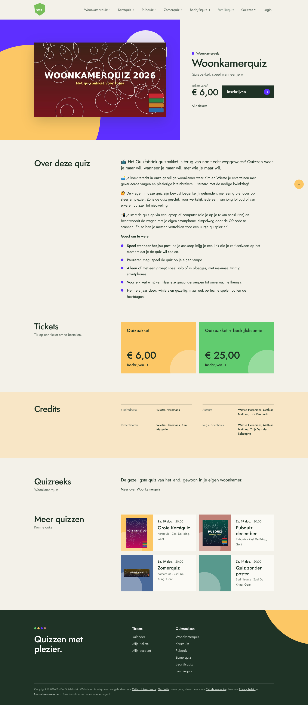 | 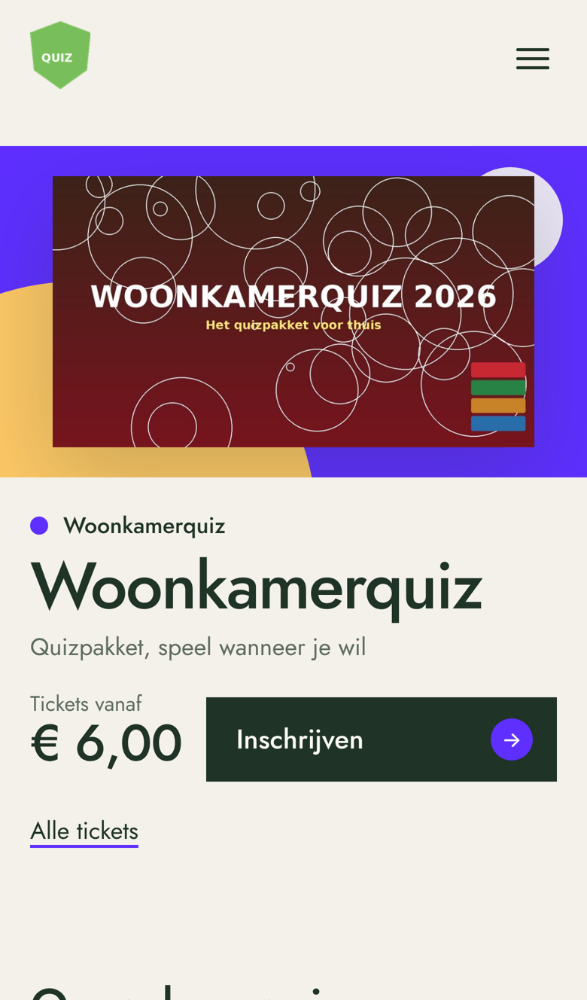 | 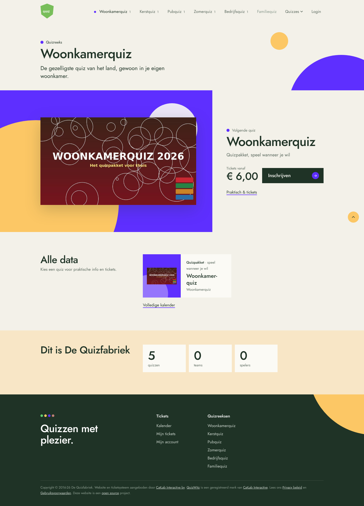 |

| Calendar, desktop | Order form, phone | Order confirmation, phone |
|---|---|---|
| 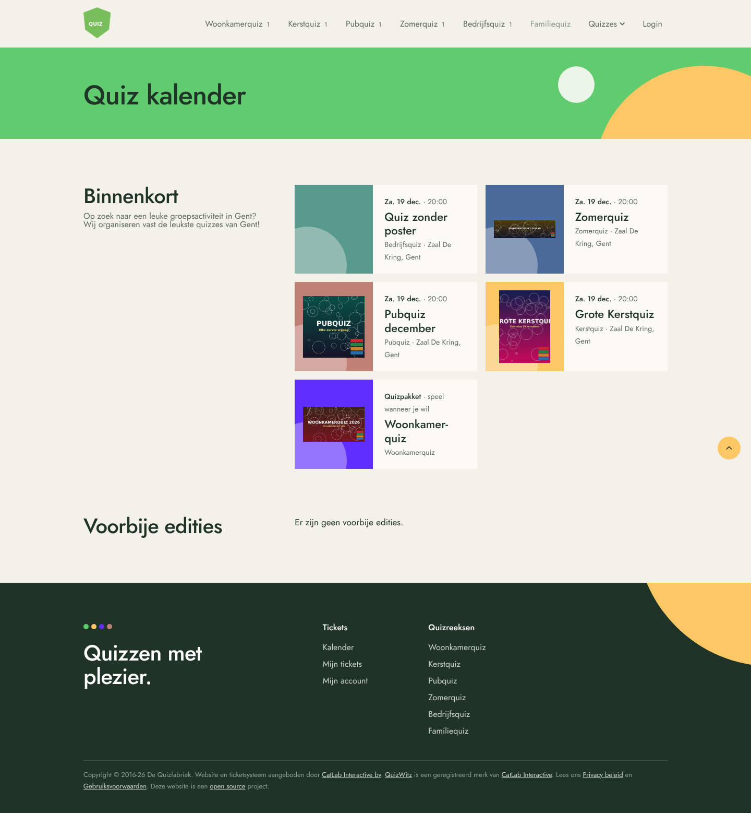 | 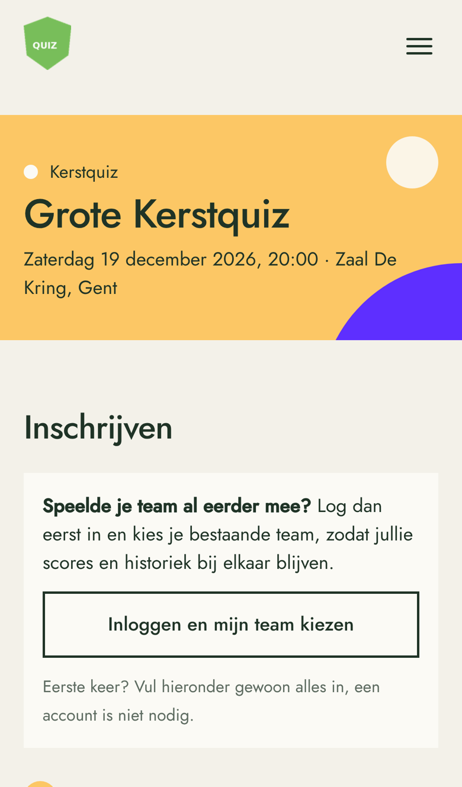 | 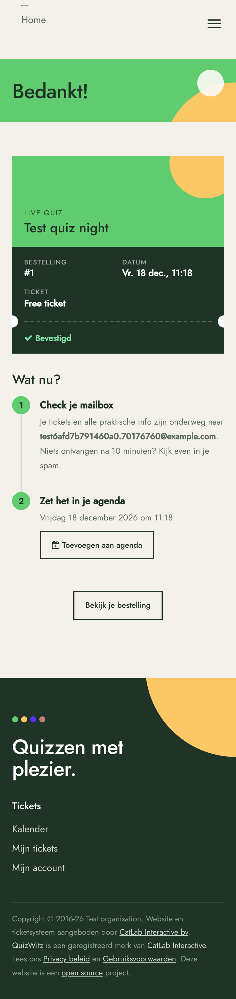 |

All screenshots of the built version: [screenshots/kleurveld](../screenshots/kleurveld/README.md)
